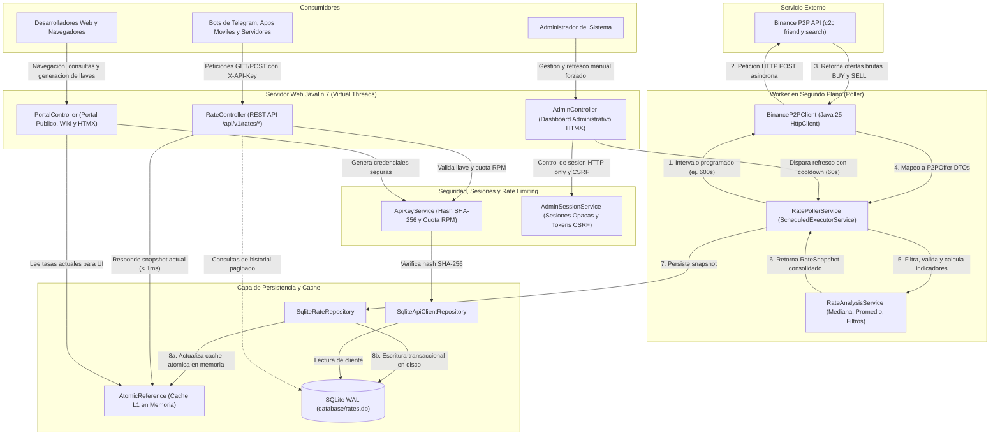
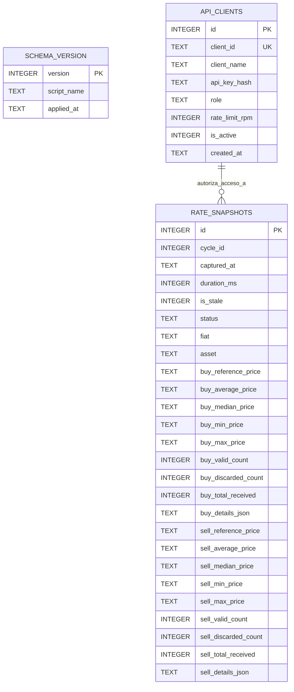

# Bolivia P2P Rates Monitor & API (BOB / USDT)

Servicio backend, API REST y portal interactivo desarrollado en Java 25 y Javalin 7, diseñado para recolectar, analizar y servir de forma transparente la cotizacion de mercado P2P de USDT en Bolivianos (BOB) desde Binance P2P hacia aplicaciones, bots y plataformas en Bolivia.

El sistema fue proyectado bajo una arquitectura austera de alta eficiencia y ultra-bajo consumo de memoria (menos de 150 MB de RAM), permitiendo su operacion ininterrumpida en la capa Always Free de Oracle Cloud Infrastructure (1 OCPU, 1 GB RAM).

---

## Regla de Oro de Arquitectura

> Binance P2P es consultado exclusivamente por el componente recolector programado en segundo plano (RatePollerService).
> Ninguna peticion de clientes, bots o desarrolladores web genera llamadas directas hacia Binance. Todas las consultas de la API y del portal se resuelven de forma instantanea desde la memoria cache y la base de datos local SQLite.

---

## Arquitectura del Sistema

El diseno desacopla el ciclo de obtencion de datos respecto a la atencion de trafico de red, eliminando el riesgo de saturacion externa o bloqueos de IP por exceso de peticiones.



### Componentes Principales

1. **BinanceP2PClient:** Cliente HTTP nativo (`java.net.http.HttpClient`) configurado con timeouts estrictos y cabeceras de emulacion de navegador para interactuar con la API Friendly Search de Binance P2P.
2. **RateAnalysisService:** Modulo de calculo estadistico. Realiza deduplicacion por identificador `advNo`, descarta anomalias (precios nulos, limites incoherentes donde `minAmount > maxAmount`), calcula la mediana muestral como indicador primario insensible a ofertas gancho, deriva el promedio muestral y agrupa cotizaciones por entidad financiera observada (Banco Union, BCP, BNB, Mercantil Santa Cruz, etc.).
3. **RatePollerService:** Coordinador del ciclo de recoleccion. Ejecuta tareas calendarizadas sin riesgo de solapamiento mediante atomicidad (`AtomicBoolean`). Aplica politica de resiliencia con estado `stale` si Binance presenta caidas de conectividad.
4. **SqliteRateRepository & Cache L1:** Repositorio hibrido. Mantiene una referencia atomica (`AtomicReference<RateSnapshot>`) que responde inmediatamente en memoria a los consumidores REST sin tocar el disco duro en consultas concurrentes.
5. **ApiKeyService & AdminSessionService:** Modulo de control de acceso. Implementa autenticacion mediante hash criptografico SHA-256 de API Keys, rate limiting en memoria por minuto (RPM) con `ConcurrentHashMap` y gestion de sesiones opacas con tokens anti-CSRF para el panel web.
6. **Javalin 7 con Virtual Threads:** Servidor web embebido sobre Jetty 12 configurado para despachar cada peticion entrante en un hilo virtual ligero de Java 25.

---

## Arquitectura de la Base de Datos

La persistencia de datos utiliza SQLite embebido en modo WAL (Write-Ahead Logging), administrado mediante migraciones versionadas ejecutadas al arranque del servicio (`DatabaseMigrator`).

### Diagrama Entidad-Relacion



### Explicacion de Tablas y Estrategia de Persistencia

#### 1. Tabla `schema_version` (Migraciones)
Controla el historial de versionado de la base de datos de manera incremental:
* `version` (INTEGER, PK): Numero correlativo de la migracion aplicada (ej. 1, 2).
* `script_name` (TEXT): Nombre exacto del archivo SQL (ej. `001_create_rate_snapshots.sql`).
* `applied_at` (TEXT): Marca temporal en formato UTC en la que se ejecuto la migracion.

#### 2. Tabla `rate_snapshots` (Historico y Metricas de Mercado)
Almacena cada toma de datos efectuada por el bot, separando con precision matematica las cotizaciones de compra y venta:
* **Identificadores y Control:**
  * `id` (INTEGER, PK): Clave primaria autoincremental.
  * `cycle_id` (INTEGER): Numero secuencial del ciclo de ejecucion del worker.
  * `captured_at` (TEXT): Timestamp ISO-8601 en UTC del momento de captura.
  * `duration_ms` (INTEGER): Tiempo total invertido en consultar Binance y procesar las muestras.
  * `is_stale` (INTEGER): Bandera booleana (0 = datos frescos, 1 = datos desactualizados por fallo de red).
  * `status` (TEXT): Estado operativo del snapshot (`OK` o `STALE`).
  * `fiat` / `asset` (TEXT): Par evaluado (por defecto `BOB` y `USDT`).
* **Metricas de Mercado de Compra (`buy_*`):**
  * `buy_reference_price`, `buy_average_price`, `buy_median_price`, `buy_min_price`, `buy_max_price`: Precios almacenados como `TEXT` para garantizar precision decimal arbitraria con `BigDecimal` sin sufrir errores de redondeo de punto flotante.
  * `buy_valid_count`, `buy_discarded_count`, `buy_total_received`: Metricas de calidad del muestreo.
  * `buy_details_json`: Documento JSON que almacena el desglose por entidad bancaria y las mejores ofertas observadas.
* **Metricas de Mercado de Venta (`sell_*`):**
  * Estructura simetrica a la de compra, preservando estadisticas y el desglose en `sell_details_json`.
* **Indices de Rendimiento:**
  * `idx_snapshots_captured_at` (DESC): Optimiza busquedas cronologicas e historiales paginados.
  * `idx_snapshots_cycle_id` (DESC): Acelera la resolucion del ciclo mas reciente.

#### 3. Tabla `api_clients` (Seguridad y Control de Acceso)
Gobierna la autorizacion de consumo para desarrolladores y administradores:
* `id` (INTEGER, PK): Clave primaria autoincremental.
* `client_id` (TEXT, UNIQUE): Slug identificador unico (ej. `client_demo_bolivia`).
* `client_name` (TEXT): Nombre descriptivo de la aplicacion o desarrollador.
* `api_key_hash` (TEXT): Hash criptografico SHA-256 en representacion hexadecimal. La llave en texto plano jamas se almacena en disco.
* `role` (TEXT): Rol de autorizacion asignado (`CONSUMER` para lectura de tasas o `ADMIN` para tareas de mantenimiento y refresco).
* `rate_limit_rpm` (INTEGER): Cuota de peticiones por minuto permitida para el cliente.
* `is_active` (INTEGER): Estado de la llave (1 = activa, 0 = revocada).
* `created_at` (TEXT): Timestamp UTC de registro del cliente.
* **Indices de Rendimiento:**
  * `idx_api_clients_hash`: Indice B-Tree para autenticacion en tiempo O(1) sobre el hash recibido.

### Optimizaciones del Motor SQLite

* **Modo WAL (Write-Ahead Logging):** Configurado mediante `PRAGMA journal_mode = WAL`. Permite lecturas masivas y concurrentes sin bloquear las operaciones de escritura del hilo recolector, y viceversa.
* **Modo de Sincronizacion Normal:** `PRAGMA synchronous = NORMAL`. Reduce escrituras innecesarias en disco garantizando consistencia contra caidas de proceso.
* **Manejo de Bloqueos:** `PRAGMA busy_timeout = 5000`. Espera hasta 5 segundos en caso de contencion de cerrojos antes de arrojar un error de concurrencia.
* **Diseno Hibrido Columna-JSON:** Las metricas financieras criticas se indexan como columnas directas para analisis rapido, mientras que los arboles de detalle bancario se guardan como cadenas JSON, evitando la proliferacion de tablas hijas y operaciones JOIN costosas.

---

## Endpoints de la API y Portal Web

### 1. Endpoints de Infraestructura y Salud (Publicos)

| Metodo | Ruta | Descripcion | Autenticacion |
| :--- | :--- | :--- | :--- |
| `GET` | `/health` | Chequeo de operatividad del servicio (`status: UP`, presencia de datos y timestamp). | Ninguna |
| `GET` | `/api/v1/status` | Diagnostico detallado: ciclo actual, edad de los datos en segundos, duracion y bandera `isStale`. | Ninguna |

### 2. Portal de Desarrolladores y Wiki (Web / HTMX)

| Metodo | Ruta | Descripcion | Autenticacion |
| :--- | :--- | :--- | :--- |
| `GET` | `/` | Portal interactivo de documentacion para desarrolladores con visualizacion de cotizaciones en tiempo real. | Ninguna |
| `GET` | `/docs` | Alias directo al portal de documentacion interactiva y ejemplos de consumo. | Ninguna |
| `GET` | `/portal/rates-card` | Fragmento HTML dinamico utilizado por HTMX para refrescar la tarjeta de tasas en segundo plano. | Ninguna |
| `POST` | `/portal/keys` | Registro self-service de nuevas API Keys con proteccion por IP (maximo 5 llaves por hora por IP). | Ninguna |

### 3. Endpoints de Datos de Mercado (API REST)

Todas las rutas bajo `/api/v1/rates/*` requieren autenticacion mediante cabecera HTTP `X-API-Key` o parametro de consulta `?apiKey=`.

| Metodo | Ruta | Parametros | Descripcion |
| :--- | :--- | :--- | :--- |
| `GET` | `/api/v1/rates/latest` | Ninguno | Snapshot consolidado completo: mercados de compra y venta, referencias, bancos y mejores ofertas. |
| `GET` | `/api/v1/rates/buy` | Ninguno | Resumen exclusivo del mercado de **COMPRA** (usuario paga BOB para recibir USDT). |
| `GET` | `/api/v1/rates/sell` | Ninguno | Resumen exclusivo del mercado de **VENTA** (usuario entrega USDT para recibir BOB). |
| `GET` | `/api/v1/rates/history` | `limit` (opcional, por defecto 10, max 100) | Coleccion cronologica de los ultimos snapshots procesados y persistidos en base de datos. |
| `POST` | `/api/v1/rates/refresh` | Ninguno | Forzado de refresco manual. Requiere rol **ADMIN**. Protegido con cooldown de 60 segundos. Si el cooldown esta activo, retorna cabecera `X-Cache: HIT-COOLDOWN`. |

#### Ejemplo de Peticion REST con cURL

```bash
curl -H "X-API-Key: tu_api_key_aqui" \
  http://localhost:8080/api/v1/rates/latest
```

#### Respuestas y Codigos de Estado HTTP

* `200 OK`: Consulta resuelta exitosamente.
* `401 Unauthorized`: API Key no proporcionada, inexistente o inactiva.
* `403 Forbidden`: Intento de refresco sin credenciales de rol `ADMIN`.
* `429 Too Many Requests`: Cuota de peticiones por minuto (RPM) del cliente superada.
* `502 Bad Gateway`: Error de comunicacion al intentar contactar a Binance P2P durante un refresco manual forzado.
* `503 Service Unavailable`: Servicio en proceso de arranque antes de capturar su primer ciclo de datos.

### 4. Panel de Administracion (Web / HTMX)

| Metodo | Ruta | Descripcion | Autenticacion |
| :--- | :--- | :--- | :--- |
| `GET` | `/admin` | Vista principal del dashboard de administracion (estado del sistema, tasas y gestion de clientes). | Cookie de sesion |
| `POST` | `/admin/login` | Inicio de sesion administrativo. Genera cookie segura `HttpOnly` y token de sesion opaco. | Master API Key |
| `POST` | `/admin/logout` | Cierre de sesion y revocacion inmediata del identificador de sesion. | Sesion activa |
| `GET` | `/admin/partials/rates` | Fragmento HTMX para auto-refresco del estado de mercado en el dashboard. | Sesion activa |
| `POST` | `/admin/refresh` | Disparador de refresco manual desde el panel respetando el cooldown configurado. | Sesion activa + CSRF |
| `POST` | `/admin/clients` | Creacion manual de clientes con rol personalizado (`CONSUMER` o `ADMIN`) y cuota RPM a medida. | Sesion activa + CSRF |
| `POST` | `/admin/clients/{id}/toggle` | Habilitacion o deshabilitacion inmediata de una credencial de cliente. | Sesion activa + CSRF |
| `DELETE` | `/admin/clients/{id}` | Eliminacion definitiva de un cliente y su llave asociada. | Sesion activa + CSRF |

---

## Optimizaciones Realizadas

El proyecto implementa tecnicas de optimizacion en multiples capas para garantizar maxima estabilidad con minimos recursos de hardware:

### 1. Optimizacion de Memoria y Runtime (Java 25)

* **Virtual Threads (Project Loom):** Habilitados en Javalin (`javalinConfig.concurrency.useVirtualThreads = true`). Las operaciones de I/O bloqueante (red y disco) se atienden sin consumir hilos pesados del sistema operativo, permitiendo atender cientos de conexiones simultaneas con una huella de memoria insignificante.
* **Custom JRE Ultraligero con `jlink`:** Mediante el script `deploy/build-custom-jre.sh`, se construye una imagen de ejecucion de Java a la medida de solo ~50 MB (frente a los >400 MB de un JDK convencional). Se incluyen unicamente los modulos requeridos (`java.base`, `java.net.http`, `java.sql`, etc.), aplicando tecnicas de stripping (`--strip-debug`, `--no-man-pages`, `--compress=zip-6`).
* **Flags de Afinacion de la JVM en Produccion:** Configurados en el servicio Systemd (`deploy/bolivia-rates.service`):
  * `-Xms64m -Xmx256m`: Limita el consumo del Heap a un techo estricto de 256 MB.
  * `-XX:MaxMetaspaceSize=80m`: Restringe el espacio de metadatos de clases cargadas.
  * `-XX:+UseSerialGC`: Recolector de basura serial de minima sobrecarga de CPU y memoria, ideal para maquinas con 1 vCPU.
  * `-XX:TieredStopAtLevel=1`: Detiene la compilacion JIT en nivel 1 (compilador C1 sin profiling complejo), reduciendo el consumo de RAM del compilador y acelerando el arranque en frio.
  * `MemoryMax=450M`: Limite de control cgroup en Systemd para impedir fugas que comprometan la VM.

### 2. Optimizacion de Persistencia y Cache

* **Cache L1 Atomica en Memoria:** `SqliteRateRepository` conserva el ultimo `RateSnapshot` en un contenedor `AtomicReference`. Las peticiones a `/latest`, `/buy` y `/sell` son atendidas en submilisegundos en memoria sin acceder al disco.
* **SQLite en Modo WAL y Sincronizacion Optimizada:** Configurado con `PRAGMA journal_mode = WAL` y `PRAGMA synchronous = NORMAL`. Evita bloqueos entre hilos de lectura y escritura, reduce llamadas `fsync` a disco y eleva el rendimiento I/O.
* **Esquema Hibrido Columna-JSON:** Las metricas primarias se indexan numericamente para filtrado instantaneo, mientras que listas anidadas de bancos y ofertas se serializan en un solo campo de texto JSON, manteniendo el archivo SQLite compacto y rapido de deserializar.

### 3. Optimizacion de Red y Proteccion contra Bloqueos de Binance P2P

* **Desacoplamiento Total:** Los clientes externos nunca interactuan con la API de Binance. El trafico saliente hacia Binance se limita exclusivamente al bot interno ejecutado a intervalos de 10 minutos (600s).
* **Cooldown en Refrescos Manuales:** Protegido por una ventana minima obligatoria de 60 segundos (`REFRESH_COOLDOWN_SECONDS`). Previene ataques de denegacion de servicio y bloqueos por parte del WAF de Binance.
* **Manejo Resiliente y Estado `stale`:** Ante interrupciones de conectividad o respuestas anormales de Binance, el sistema no colapsa ni retorna errores vacios: continua entregando el ultimo snapshot valido en cache marcando explicitamente `isStale=true`.
* **Depuracion y Filtrado Estadistico:** Descarte de anuncios duplicados mediante seguimiento de `advNo`, eliminacion de anomalias con limites incoherentes y adopcion de la mediana como medida de tendencia central inmune a ofertas desproporcionadas o manipuladas.

### 4. Optimizacion de Seguridad y Control de Concurrencia

* **Rate Limiting O(1) en Memoria:** Verificacion de cuota de peticiones por minuto (RPM) implementada mediante ventanas temporales y contadores atomicos (`ClientRateTracker` con `AtomicInteger` en `ConcurrentHashMap`), evitando consultas a base de datos en cada verificacion de cuota.
* **Hash Criptografico SHA-256:** Las API Keys solo existen en memoria en el momento de su creacion. En la base de datos se almacena unicamente su representacion hash SHA-256 indizada.
* **Proteccion Anti-Abuso en el Portal:** El registro publico de API Keys incorpora una triple barrera: verificacion estricta de cabeceras Origin/Referer, limite de 5 llaves por hora por direccion IP y cooldown de 5 segundos entre solicitudes consecutivas.
* **Sesiones Administrativas Opacas y CSRF:** El dashboard web utiliza identificadores de sesion criptograficos aleatorios almacenados en memoria con expiracion automatica y tokens anti-CSRF por sesion, evitando exponer llaves maestras en cookies de navegacion.

### 5. Optimizacion de Frontend (Arquitectura Hypermedia)

* **Thymeleaf + HTMX:** Todo el portal de desarrolladores y el panel de administracion se construyen mediante renderizado del lado del servidor (SSR) y fragmentos dinamicos impulsados por HTMX. Esto prescinde completamente de frameworks SPA pesados (como React, Angular o Vue), reduciendo a cero el empaquetado de JavaScript externo y garantizando tiempos de carga casi instantaneos.

---

## Variables de Entorno (Configuracion)

| Variable | Valor por Defecto | Descripcion |
| :--- | :--- | :--- |
| `PORT` | `8080` | Puerto TCP de enlace del servidor HTTP. |
| `POLL_INTERVAL_SECONDS` | `600` | Intervalo en segundos entre consultas programadas a Binance (10 minutos recomendado en produccion). |
| `REFRESH_COOLDOWN_SECONDS` | `60` | Segundos minimos de espera obligatoria entre ejecuciones de refresco manual. |
| `BINANCE_FETCH_ROWS` | `10` | Cantidad de ofertas muestreadas por cada sentido de operacion (compra y venta). |
| `FIAT_CURRENCY` | `BOB` | Moneda fiat de referencia local. |
| `ASSET_CURRENCY` | `USDT` | Criptoactivo evaluado. |
| `SQLITE_DB_PATH` | `database/rates.db` | Ruta del archivo de base de datos SQLite embebida. |
| `PUBLIC_BASE_PATH` | *(vacio)* | Prefijo de ruta base publica en despliegues tras proxy inverso (ej. `/bolivia-rates`). |
| `ADMIN_API_KEY` | *(opcional)* | Clave maestra opcional inyectada para inicializar o sincronizar la cuenta administrativa. |

---

## Compilacion y Ejecucion

### 1. Requisitos Previos

* Java Development Kit (JDK) 25 o superior.
* Apache Maven 3.9 o superior.

### 2. Ejecutar Pruebas Unitarias y de Integracion

```bash
mvn test
```

### 3. Compilar y Empaquetar el Fat JAR

```bash
mvn clean package
```

El artefacto ejecutable se generara en la ruta:
`target/bolivia-p2p-rates-0.1.0-SNAPSHOT.jar`

### 4. Ejecutar en Entorno de Desarrollo Local

```bash
java -jar target/bolivia-p2p-rates-0.1.0-SNAPSHOT.jar
```

Para pruebas locales rapidas con intervalo de consulta cada 60 segundos:

```bash
POLL_INTERVAL_SECONDS=60 java -jar target/bolivia-p2p-rates-0.1.0-SNAPSHOT.jar
```

---

## Despliegue en Produccion (Oracle Cloud Always Free)

### 1. Construir el Custom JRE

En la maquina host de produccion (Ubuntu x86_64), ejecute el script generador de JRE minimo:

```bash
chmod +x deploy/build-custom-jre.sh
./deploy/build-custom-jre.sh
```

### 2. Configuracion con Systemd

Copie la unidad de servicio y active el daemon del sistema:

```bash
sudo cp deploy/bolivia-rates.service /etc/systemd/system/
sudo systemctl daemon-reload
sudo systemctl enable bolivia-rates
sudo systemctl start bolivia-rates
```

Para monitorear los logs del servicio en tiempo real:

```bash
journalctl -u bolivia-rates -f
```
